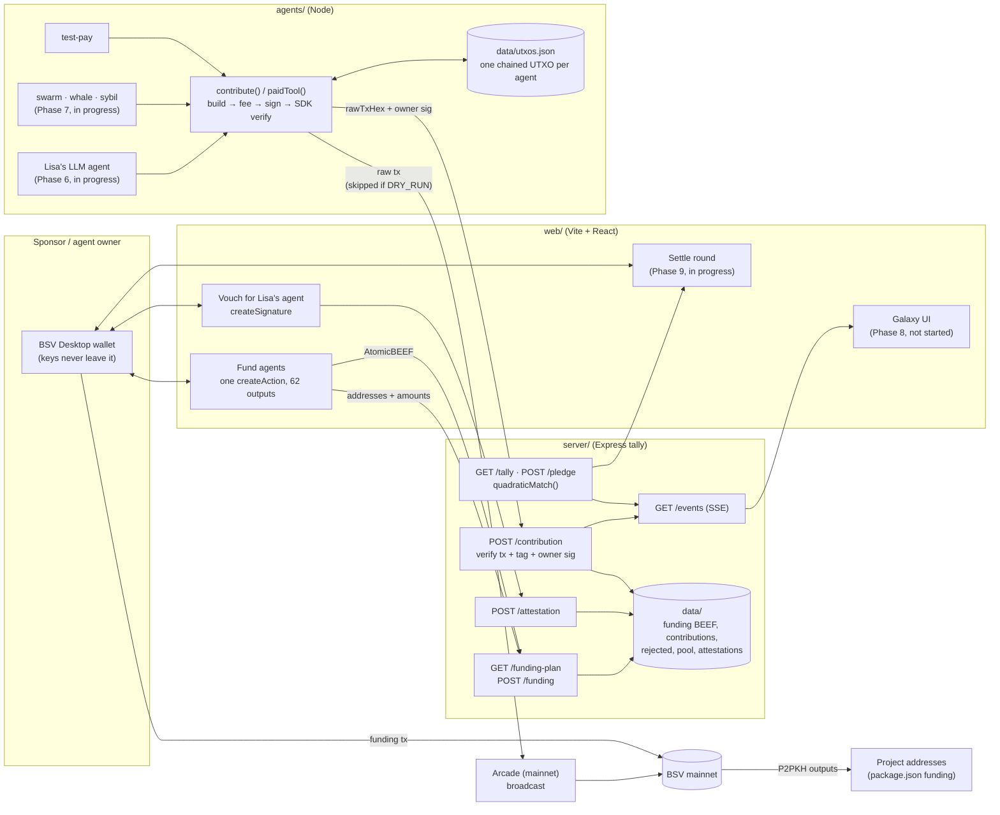

# Architecture

Upstream has four parts in one npm-workspaces monorepo (TypeScript throughout, `tsx` to run scripts, `@bsv/sdk` 3.2.1):

| Workspace | Role |
|---|---|
| `shared/` | Code used by all the others: the budget guard, runtime/DRY_RUN, the project registry, quadratic matching, the OP_RETURN tag, owner attestations. Isomorphic, so the same code runs in the browser and in Node. |
| `server/` | Express tally server. It's the only part that reads `keys/`. It owns the funding plan, verifies contributions, runs matching, and streams events. It **never holds or returns a private key**. |
| `agents/` | Node scripts that hold agent keys and make contributions: `contribute()` / `paidTool()`, plus key generation, seeding and import. |
| `web/` | Vite + React page that talks to BSV Desktop through `WalletClient('auto')`. All user signing happens in the wallet. |

## Diagram



## The flows

### 1. Funding the agents (Phase 3, built)

1. The browser calls `GET /funding-plan?scope=lisa|all`. The server reads `keys/` and returns the **addresses and amounts only**, taken from `.env` through `shared/budget.ts`.
2. `web/src/wallet.ts` makes **one** `createAction` with one P2PKH output per agent, `randomizeOutputs: false`. BSV Desktop signs and broadcasts it.
3. The browser posts `{ scope, txid, beefHex }` to `POST /funding`. The server checks that the AtomicBEEF really is that txid, saves it to `data/`, and resolves every output to its agent **by locking script**, never by position.
4. Backup path: after a manual Send from BSV Desktop, `npm run import-funding <txid>` fetches the tx once from WhatsOnChain and records the agent outputs.

### 2. Owner attestation (the Sybil defence)

- Every agent has an owner. The owner signs the agent's compressed public key with protocol `[1, 'upstream agent']`, key id `agent`, `counterparty: 'anyone'` (`shared/attestation.ts`). Security level 1 means the wallet asks before signing.
- **Lisa's** owner is the user's BSV Desktop identity key (web page step 5). `POST /attestation` verifies the signature, stores it only if it verifies, refuses to re-assign an agent to a different owner, and only accepts agents that `npm run keys` generated.
- **Swarm and whale** owners are generated keys that sign through the SDK's `ProtoWallet`.
- **Sybil** agents have no owner.
- Anyone can verify an attestation with `ProtoWallet('anyone')` and the owner's public key. No shared secret is needed.

### 3. A contribution (Phase 4, built)

`agents/lib/contribute.ts` builds one transaction:

| Output | Script | Sats |
|---|---|---|
| 0 | P2PKH to the project | `CONTRIBUTION_SATS` |
| 1 | `OP_FALSE OP_RETURN "UPSTREAM\|<round>\|<projectId>"` | 0 |
| 2 | P2PKH change back to the agent | the rest, minus fee |

Then: fee at 1 sat/kB → sign → **SDK script verification of the input** (`Spend.validate()`) → broadcast to Arcade as Extended Format (**skipped when `DRY_RUN=true`**). Output 2 becomes the agent's next UTXO in `data/utxos.json`, so contributions chain unconfirmed and one funding output covers hundreds of payments. Finally the agent posts `{ rawTxHex, projectId, agentPubKey, ownerPubKey, ownerSignature, dryRun }` to the server.

`paidTool(projectId, fn, …)` wraps any function so it pays first and runs second. If the payment throws, the tool never runs.

### 4. Verification and tally (Phase 5, built)

`POST /contribution` (`server/src/contributions.ts`) **trusts nothing from the reporter**. Everything comes from the raw transaction:

1. The project must be known.
2. An OP_RETURN must carry `UPSTREAM|<round>|<projectId>` for **this** round, naming the same project as the report.
3. An output must pay that project's address (found by locking script) at least `CONTRIBUTION_SATS`.
4. The owner's signature over the agent key must verify.

A valid contribution is stored (idempotent on txid + output index) and emits `contribution` + `tally` events. An invalid one is stored in `rejected.json` and emits `rejected`, which is how the Sybil attack shows up.

`GET /tally` runs `quadraticMatch` (exactly as in the brief, with `GAP_EPSILON = 1e-6`) over this round's contributions, **grouped by owner**:

```
gap(project)   = (Σ over owners √sats)² − raised
match(project) = floor(gap / Σ gaps × pool)
```

The unit test: whale (1 owner × 50,000) vs crowd (500 owners × 10) vs medium (50 owners × 100), pool 100,000 → crowd ≈ 91,000, medium ≈ 9,000, whale **0**. A single owner has no gap, however much they pay.

`POST /pledge { pool }` sets the sponsor's pool. It's a pledge only: the satoshis stay in the sponsor's wallet. `GET /events` is an SSE stream that replays the last 50 events to new listeners.

### 5. Settlement (Phase 9, in progress in a parallel session)

Planned: `GET /settlement/preview` builds one P2PKH output per project with `match > 0` plus an OP_RETURN with the SHA-256 of the round results JSON, and the web page's "Settle round" button pays it from BSV Desktop with `createAction`. The pool goes **straight from the sponsor's wallet to the projects**.

## Server endpoints

| Method | Path | Purpose |
|---|---|---|
| GET | `/health` | Round, network, pool, counts, full budget. |
| GET | `/funding-plan?scope=lisa\|all` | Addresses + amounts for the funding tx. |
| POST | `/funding` | Record a broadcast funding tx (AtomicBEEF). |
| GET | `/funding` | Funding records so far. |
| GET | `/agent/lisa` | Lisa's agent public key and attestation status. |
| POST / GET | `/attestation` | Store / list owner attestations. |
| POST | `/contribution` | Report a contribution. |
| GET | `/contribution` | Accepted + rejected contributions. |
| GET | `/tally` | Quadratic matching result for the round. |
| POST | `/pledge` | Set the sponsor's matching pool. |
| GET | `/events` | SSE: `contribution`, `rejected`, `tally`, `settled`. |

## Design rules we hold to

- **Non-custodial.** Agents pay projects directly. The sponsor pays matching from their own wallet. Nobody holds pooled funds, and no server key controls anyone's money.
- **Keys never leave their wallet.** The user signs in BSV Desktop. Agent keys stay in gitignored `keys/` and are read only by Node scripts and the server, which never sends a private key over HTTP. The browser never sees `keys/`.
- **No hard-coded amounts.** Every satoshi figure comes from `.env` through `shared/budget.ts`, which refuses an over-budget configuration.
- **Outputs found by locking script, never by index.**
- **One code path for dry-run and live.** Only the broadcast differs.
- **Auditable from the chain.** The OP_RETURN tag and the owner attestations let anyone recompute the tally without trusting our server.

## Data files (`data/`, gitignored)

| File | Written by | Content |
|---|---|---|
| `funding-<scope>-<txid>.beef`, `funding.json` | `POST /funding` | AtomicBEEF hex, and the output → agent map. |
| `utxos.json` | agents | Each agent's current spendable output (`synthetic` flag for dry-run coins). |
| `attestations.json` | `POST /attestation` | Verified owner signatures. |
| `dry-run-owners.json` | agents, dry-run only | Simulated owners for Lisa while BSV Desktop is unavailable. Never posted as attestations. |
| `contributions.json` / `rejected.json` | `POST /contribution` | Counted and refused contributions. |
| `pool.json` | `POST /pledge` | The sponsor's pledged pool. |

Tests set `UPSTREAM_DATA_DIR` to a temp directory, so running the suite never touches a real round's data.
